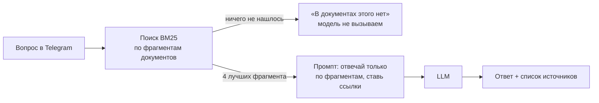

<div align="center">

# rag-telegram-bot

**Telegram-бот, который отвечает клиентам по документам компании и показывает, откуда взял ответ.**
Если ответа в документах нет, он так и говорит и ничего не выдумывает.


</div>

## Пример

```
$ python -m app.cli "Сколько стоит доставка курьером?"
Доставка курьером по Новосибирску стоит 300 рублей [1]. При заказе от 5000 рублей доставка по городу бесплатная [1].
  [1] dostavka.md — Стоимость доставки

$ python -m app.cli "Какая гарантия на мебель?"
В документах этого нет. Лучше уточнить у менеджера.
```

## Что умеет

- ищет нужные куски в документах (`.md`, `.txt`, `.pdf`)
- отвечает через любую OpenAI-совместимую модель: DeepSeek, GLM, Qwen или локальную через Ollama
- ставит ссылки на источник `[1]`, `[2]` и перечисляет файлы под ответом
- если поиск ничего не нашёл, в модель не ходит и токены не тратит
- проверяет качество на наборе вопросов: поиск, факты в ответе, честный отказ, время и токены

## Как устроено



| Файл | Что делает |
|---|---|
| `app/loader.py` | читает документы и режет их по заголовкам на фрагменты |
| `app/retriever.py` | поиск BM25, своя реализация на ~40 строк |
| `app/rag.py` | собирает промпт, спрашивает модель, решает, когда отказать |
| `app/llm.py` | клиент к OpenAI-совместимому API |
| `app/bot.py` | Telegram-бот на aiogram |
| `eval/run_eval.py` | проверка качества на `eval/questions.jsonl` |

**Почему BM25, а не векторная база.** Для базы знаний на десятки или сотни страниц этого хватает, работает без GPU и внешних сервисов, и его легко отлаживать. Векторный поиск можно добавить следующим шагом, если документов станет много или вопросы начнут сильно расходиться по словам с текстом.

**Почему модель может отказать.** В промпте прямо сказано отвечать только по фрагментам, а при отсутствии ответа выдавать одну фиксированную фразу. По этой фразе код понимает, что это отказ, и не показывает источники.

## Запуск

```bash
python -m venv .venv
.venv\Scripts\activate            # Linux/macOS: source .venv/bin/activate
pip install -r requirements.txt
cp .env.example .env              # вписать LLM_API_KEY, LLM_MODEL и TELEGRAM_TOKEN

python -m app.cli "Сколько стоит доставка?"   # спросить из терминала
python -m app.cli --search "возврат"          # посмотреть, что нашёл поиск
python -m app.bot                              # запустить бота
```

Через Docker:

```bash
docker build -t rag-bot .
docker run --env-file .env rag-bot
```

## Проверка качества

```bash
python -m eval.run_eval --retrieval-only   # только поиск, без модели и без затрат
python -m eval.run_eval                    # с моделью, отчёт пишется в eval/report.md
pytest
```

Набор: 22 вопроса. На 15 ответ в документах есть, на 7 нет, и бот должен честно отказать. Три из этих семи с подвохом: поиск находит похожий раздел («гарантия на мебель» при гарантии только на электронику), и отказать должна уже сама модель.

Результат с моделью `deepseek-v4.1-flash-1017` (полный отчёт в [`eval/report.md`](eval/report.md)):

| Метрика | Результат |
|---|---|
| Поиск: нужный документ первым | 15 / 15 |
| В ответе есть нужные факты | 15 / 15 |
| Ответ со ссылкой на источник | 15 / 15 |
| Честный отказ, когда ответа нет | 7 / 7 |
| Из них отказ без вызова модели (0 токенов) | 4 / 7 |
| Среднее время ответа | 2,3 с |
| Токены за весь прогон | 6486 + 489 |

Что нашлось по пути:
- поиск сначала обрезал слова до 6 букв, и «оплатить» не находило «оплату», нужный документ был первым в 12 из 15. На 5 буквах стало 15 из 15;
- под ответом показывались все 4 найденных фрагмента, даже если модель сослалась на один. Теперь показываются только те, на которые она реально сослалась;
- первые 4 вопроса без ответа отсекались ещё на поиске, и умение модели отказывать вообще не проверялось. Добавил 3 вопроса с подвохом, чтобы проверять и её.

## Демо-данные

В `docs/` лежат документы вымышленного магазина «Пример». Чтобы бот отвечал по вашим, положите свои файлы в `docs/` или укажите папку в `DOCS_DIR`.

## Как сделано

Сделано вместе с ИИ (Claude Code). Код покрыт тестами и проверен прогоном на наборе вопросов.

## Лицензия

MIT
